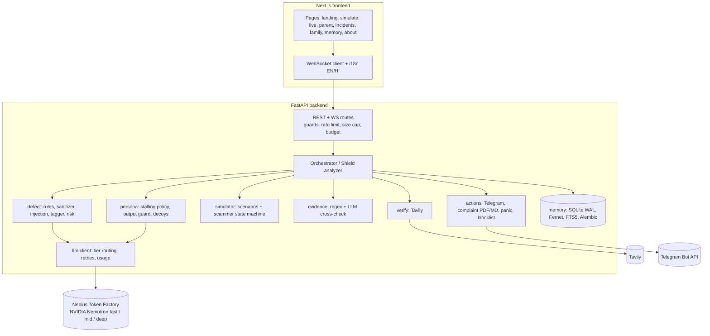

# Architecture

## Components



## One honeypot turn

```mermaid
sequenceDiagram
  participant UI
  participant O as Orchestrator
  participant S as Scammer sim (mid)
  participant D as Detector (rules + fast)
  participant M as Memory
  participant E as Evidence + Tavily
  participant P as Persona (mid) + guard
  UI->>O: control start (WS)
  loop each turn
    O->>S: next line (stage state machine)
    S-->>O: scripted/LLM line (fictional identifiers only)
    O->>D: tag (raw text for rules; sanitized + delimited for LLM)
    D-->>O: tactics, stage, money flag
    O->>M: recognise tactic prefix?
    M-->>O: hit -> risk floor (learned prior)
    O->>UI: tactics, risk, memory_hit
    O->>E: extract identifiers; verify (once each)
    E-->>UI: evidence, verification
    O->>P: reply(history, missing identifiers)
    P-->>O: guarded reply (decoy data only)
    O->>UI: persona_reply, time_wasted
  end
  O->>M: persist encrypted transcript, learn script
  O->>UI: summary (incident id)
```

## Key design decisions

See [DECISIONS.md](DECISIONS.md). Highlights: rules are authoritative and local; the LLM adds recall but never sees unmasked personal numbers; the risk score is monotonic within a conversation; payment demand under coercion is critical by definition; memory acts as a learned prior (a recognised script lifts risk to *high* immediately).

## Data

SQLite (WAL) via SQLAlchemy 2 async; Postgres-ready through `DATABASE_URL`. Utterance text is Fernet-encrypted. FTS5 index over script phrases lives next to the ORM tables (excluded from Alembic autogenerate). Migrations: `alembic upgrade head`.
