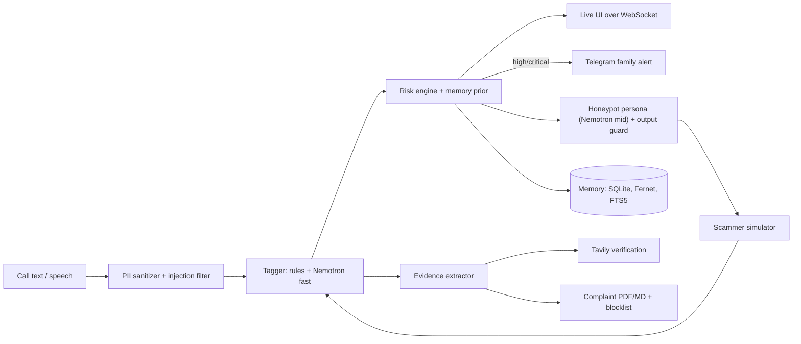

# SCAM-KHEL

**A private, always-on family shield against Indian "digital arrest" scams.**
Built for the Nebius x NVIDIA Global AI Hackathon, Personal AI track.

> **Simulation only.** The honeypot talks to a built-in, fictional scammer simulator (every agency is labelled `(SIMULATION)`). SCAM-KHEL does not intercept real calls, never contacts real scammers, and never files anything for you.

<!-- Screenshots / GIF to add before submission (see docs/MANUAL_STEPS.md):
  docs/screenshots/01-landing.png      landing + consent sheet
  docs/screenshots/02-simulate.png     split view: transcript | risk | evidence | Tavily | memory banner
  docs/screenshots/03-parent.png       Parent view + panic flow
  docs/screenshots/04-complaint.png    complaint PDF
  docs/screenshots/hero.gif            risk climbing during a simulation (<= 10 s)
-->

## The problem

Fraudsters impersonate police, CBI, ED or customs, claim you or a family member is implicated in a crime, keep you "visible" on a video call, tell you not to tell anyone, and demand a transfer to a "safe / verification account". Indian authorities state that police, CBI, ED and courts do not arrest people over video calls. If money is lost, call helpline **1930** and report at **https://cybercrime.gov.in**.

## What it does

| Mode | What happens |
|---|---|
| **Shield** (detect) | Paste, speak or stream what a caller said. Tactics are tagged live (13 coercion tactics, English / Hindi / Hinglish), a 0-100 risk score climbs through `caution ≥40`, `high ≥70`, `critical ≥85`, with a plain-language explanation and a "what to do now" list. |
| **Honeypot** (bait) | A decoy "confused grandmother" persona stalls a **simulated** scammer, asks for names, IDs, numbers and payment details, and the evidence panel fills. A time-wasted counter climbs. |
| **Parent view** | Very large buttons: "Is this a scam?" and a red **"I already sent money"** flow (1930 checklist, call script, pre-filled transaction form, complaint draft). |
| **Memory** | Scam scripts are fingerprinted and remembered. A repeat run shows *"Recognised pattern from Incident #N, flagged at turn k vs turn m earlier"*. |
| **Actions** | Telegram family alert, complaint draft (PDF + Markdown) for cybercrime.gov.in, blocklist export (CSV/JSON). |

## How it uses Nebius Token Factory + NVIDIA Nemotron

All runtime LLM calls go to **Nebius Token Factory** (OpenAI-compatible API) and use **NVIDIA Nemotron** models in three cost tiers. Model IDs are never hard-coded: set `MODEL_FAST`, `MODEL_MID`, `MODEL_DEEP`, and run `make check-models` to list the Nemotron models your account can use, smoke-test each tier, probe tool-calling / JSON support, and write `docs/model_report.md`.

| Tier | Env var | Used for | Why this tier |
|---|---|---|---|
| **Fast** (small Nemotron) | `MODEL_FAST` | Per-utterance tactic tagging; prompt-injection classifier on ambiguous text | Runs on every message, so it must be cheap and quick |
| **Mid** (mid-size Nemotron) | `MODEL_MID` | Honeypot persona, scammer simulator, semantic evidence cross-check | Needs fluent, in-character Hinglish |
| **Deep** (largest Nemotron) | `MODEL_DEEP` | Final analysis and complaint narrative | Runs once per incident; quality matters more than latency |

`app/llm/client.py` provides the async client, retries with jitter on 429/5xx, per-tier routing, streaming, `<think>` stripping, a JSON-schema protocol with pydantic validation and up to two repair retries, a request ID in every log line, and **per-tier token accounting** exposed at `GET /api/admin/usage` (the cost-tiering proof).

**Token usage by tier:** the table is produced by `make eval-live` (needs a Token Factory key) and by `/api/admin/usage`. The repository ships the *offline* eval run, which makes zero LLM calls, so there are no token figures to quote yet; none are invented here. See [`evals/report.md`](backend/evals/report.md).

### Where Tavily is used

`app/verify/tavily_verifier.py` makes runtime calls (visible in the UI under "Public-source checks" and in the logs) to (a) fetch the current official advisory text restricted to `cybercrime.gov.in`, `pib.gov.in`, `mha.gov.in`, `rbi.org.in` and similar, (b) check the claimed agency against official sources, and (c) best-effort search for public reports of an extracted phone number or UPI ID. Results are cached, quota errors degrade gracefully, and **"no public reports found" is always labelled as *not* meaning safe**.

## Architecture



More diagrams in [ARCHITECTURE.md](ARCHITECTURE.md).

## Quickstart (< 10 min)

Prerequisites: Python 3.11+, Node 20+, a Nebius Token Factory key (optional: without it the app runs in clearly-flagged **offline mode** using rules + scripted fallbacks).

```bash
git clone <your-fork-url> scam-khel && cd scam-khel
cp .env.example .env            # fill NEBIUS_API_KEY and MODEL_* (see docs/MANUAL_STEPS.md)
make setup                      # backend deps
cd frontend && npm install && cd ..
make check-models               # lists Nemotron models, validates tiers, writes docs/model_report.md
make test                       # backend tests
make eval                       # offline eval -> backend/evals/report.md + table below
make demo                       # seeds two prior incidents so the memory-hit moment is reproducible
make dev                        # API on :8000   (second terminal: cd frontend && npm run dev)
```

Open <http://localhost:3000/?client=demo-client-0001> to see the seeded incidents. Or: `docker compose up --build`.

Deploy: frontend on Vercel (`NEXT_PUBLIC_API_URL` = your API URL); backend container (`backend/Dockerfile`) on Render / Fly / Railway with a persistent volume at `/data`, `DEMO_MODE=true`, `FRONTEND_ORIGIN` = the Vercel URL, `ADMIN_TOKEN` and `FERNET_KEY` set. Details in [docs/MANUAL_STEPS.md](docs/MANUAL_STEPS.md).

### Environment variables

See [`.env.example`](.env.example): every variable is documented there (Nebius, three model tiers, Tavily, Telegram, Fernet key, retention, `DEMO_MODE`, `DAILY_TOKEN_BUDGET`, per-IP limits, optional ASR/TTS endpoints).

## Evaluation results

Measured by `make eval` (offline, deterministic), never hand-written. Full report: [backend/evals/report.md](backend/evals/report.md).

<!-- EVAL:START -->
| Metric | Result |
|---|---|
| Eval set | 43 dialogues (26 scam / 17 legit; EN, Hindi, Hinglish) |
| Precision / recall / F1 @ high (≥70), all | 1.0 / 0.962 / 0.98 |
| Same, held-out set only (21) | 1.0 / 0.917 / 0.957 |
| False-positive rate on legit (all / held-out) | 0.0 / 0.0 |
| Mean scammer turns to reach high | 2.32 |
| Critical by first payment demand | 0.885 |
| Honeypot engaged turns / time wasted (mean, 7 scenarios) | 10.1 / 438s |
| Identifier types extracted per session (mean) | 7.6 |
| Persona leakage rate (guard violations per persona turn) | 0.0000 |
| Memory benefit: turns saved on 2nd exposure (mean) | 1.43 |
| Run mode | offline (rules + scripted fallbacks, no LLM) |
<!-- EVAL:END -->

Read the numbers honestly: the rules-only detector is weakest on paraphrase, and the *tuned* set is optimistic. One held-out false positive (a public scam-awareness advisory) was fixed after it was observed, so the held-out figures are post-fix. `make eval-live` measures the Nemotron-assisted pipeline once a key is configured.

## DEMO_MODE (keeps the public demo alive until Dec 15)

`DEMO_MODE=true` enforces a global daily token budget, per-IP session limits, a max-turns cap and request-size caps. When the budget is exhausted, live sessions degrade to **pre-recorded replays, clearly labelled "replay"**, Shield keeps working on rules alone (zero tokens), and `/healthz` exposes the budget. There is never a blank screen. Tested by forcing exhaustion (`tests/test_api.py`).

## Safety and privacy (summary)

- The persona only ever uses a fixed fictional decoy identity; an **output guard** blocks and rewrites anything resembling Aadhaar, PAN, card numbers, OTPs, real phone numbers or non-decoy UPI IDs, and any agreement to pay / install / click. Tested against 37 hostile outputs and a 220-case obedient-model matrix: leakage 0.
- Scammer text is untrusted: heuristics + a classifier prompt, structural delimiting, never concatenated into system prompts.
- Personal numbers are masked and family names pseudonymised before any LLM call; transcripts are encrypted at rest (Fernet); 30-day retention purge; "delete everything" endpoint and button; DPDP-style consent screen with a stored consent record; no audio stored.
- See [PRIVACY.md](PRIVACY.md) and [SECURITY.md](SECURITY.md).

## Honest limitations

- No real-call interception. The honeypot is simulation-only; real telephony is future work and intentionally absent.
- Complaints are drafts. You review and file them yourself.
- Detection can be wrong; treat it as a second opinion. Tavily results are best-effort.
- Voice uses the browser's Web Speech API by default, which is **not** an NVIDIA model. NVIDIA ASR/TTS adapters exist but are unverified; the NVIDIA-model requirement is met by Nemotron on Token Factory.
- Live Token Factory, Tavily and Telegram paths are implemented and unit-tested against mocks; they have not been exercised against the real services in this repository's history (no keys were available while building). See [docs/FINAL_AUDIT.md](docs/FINAL_AUDIT.md).

## Roadmap

Real bait-line telephony behind a feature flag with consent notice (disabled, future work), on-device ASR, more regional languages, bank/telecom blocklist integrations, embeddings-based script retrieval when available on Token Factory.

## License

MIT. See [LICENSE](LICENSE).
